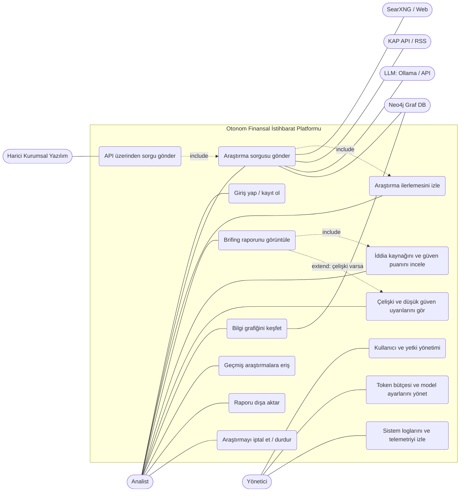

# Use Case Diyagramı

Mermaid'de yerel use case diyagramı bulunmadığı için `flowchart` ile gösterilmiştir. Aktörler yuvarlak, use case'ler oval, sistem sınırı kutu olarak çizilmiştir.

## Aktörler

| Aktör | Tür | Açıklama |
|-------|-----|----------|
| Analist | Birincil | Araştırma sorusunu girer, brifingi okur, kaynakları inceler |
| Yönetici | Birincil | Kullanıcıları, bütçeyi ve model ayarlarını yönetir, logları izler |
| Harici Kurumsal Yazılım | İkincil | Platformu REST API üzerinden çağıran diğer sistemler (REQ-05) |
| SearXNG / Web | Dış sistem | Güncel web kaynaklarını sağlar |
| KAP API / RSS | Dış sistem | Resmi bildirimler ve doğrulanmış besleme (bot engeli durumunda yedek) |
| LLM (Ollama / API) | Dış sistem | Alt sorgu üretimi, varlık-ilişki çıkarımı, rapor yazımı |
| Neo4j | Dış sistem | Bilgi grafiği depolama ve GraphRAG sorguları |

## Use case – ister eşlemesi

| Use case | İlgili ister |
|----------|--------------|
| UC1, UC2, UC9 | REQ-01 Otonom Tarama |
| UC6 | REQ-02 Dinamik Ağ Kurulumu |
| UC3, UC4, UC8 | REQ-03 Şeffaf Kaynak Gösterimi |
| UC5 | REQ-04 Güvenilirlik Damgası |
| UC13, UC12 | REQ-05 Düşük Gecikmeli API Servisi |
| UC4 (atıf denetimi) | REQ-06 Kaynak Denetimi ve Güvenlik |
