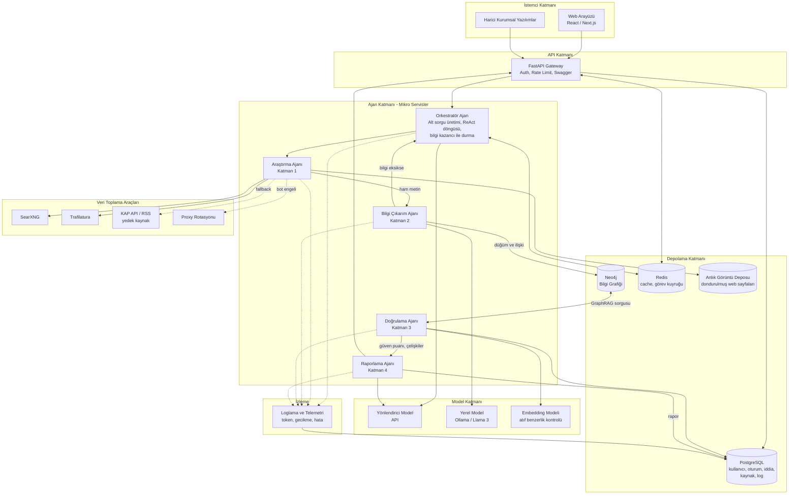

# Sistem Mimarisi

Öneri formundaki dört katman (arama, çıkarım, doğrulama, raporlama), mikro servisler ve altyapı bileşenleriyle birlikte gösterilmiştir.

## Bileşen açıklamaları

| Bileşen | Sorumluluk | İlgili ister |
|---------|------------|--------------|
| FastAPI Gateway | Kimlik doğrulama, istek yönlendirme, Swagger dokümantasyonu | REQ-05 |
| Orkestratör Ajan | Sorguyu alt sorulara böler, ReAct döngüsünü yönetir, bilgi kazancı eşiği ve token bütçesiyle durdurur | REQ-01 |
| Araştırma Ajanı | SearXNG ile arar, Trafilatura ile metni çeker, bot engelinde proxy ve KAP/RSS yedeğine geçer | REQ-01 |
| Bilgi Çıkarım Ajanı | Metinden varlık ve ilişkileri çıkarır, Neo4j'ye düğüm ve ilişki olarak yazar | REQ-02 |
| Doğrulama Ajanı | Çapraz doğrulama, dairesel raporlama tespiti, yayıncı güven puanı, atıf-metin benzerlik kontrolü | REQ-04, REQ-06 |
| Raporlama Ajanı | Tıklanabilir kaynak, erişim tarihi ve güven damgalı brifing üretir | REQ-03, REQ-04 |
| Neo4j | Bilgi grafiği ve multi-hop GraphRAG sorguları (derinlik 2-3 ile sınırlı) | REQ-02 |
| PostgreSQL | Kullanıcı, oturum, kaynak, iddia, atıf ve metrik kayıtları | REQ-03, REQ-05 |
| Redis | Sık sorulan ilişkiler için cache, ajanlar arası görev kuyruğu | Risk planı (gecikme) |
| Anlık Görüntü Deposu | Çekilen sayfaların dondurulmuş kopyaları, test kümesi için temel | Çıktı: dondurulmuş test kümesi |
| Loglama ve Telemetri | Token kullanımı, p@95 gecikme, uydurma atıf oranı ölçümü | REQ-05, REQ-06 |

## Tasarım kararları

- **Hibrit depolama:** İlişkisel veri (kullanıcı, oturum, log) PostgreSQL'de, bilgi grafiği Neo4j'de tutulur. Her graf ilişkisi `source_id` ile PostgreSQL'deki kaynak kaydına bağlanır.
- **Model ayrımı:** Pahalı API modeli yalnızca orkestratör ve rapor yazımında, standart çıkarım işleri yerel modelde çalışır (token maliyeti riski için B planı).
- **Fallback zinciri:** Bot engeli → proxy değişimi → KAP API / RSS beslemesi.
- **Her ajan ayrı servis:** Bağımsız ölçeklenebilir, bağımsız loglanabilir ve test edilebilir (REQ-05).
