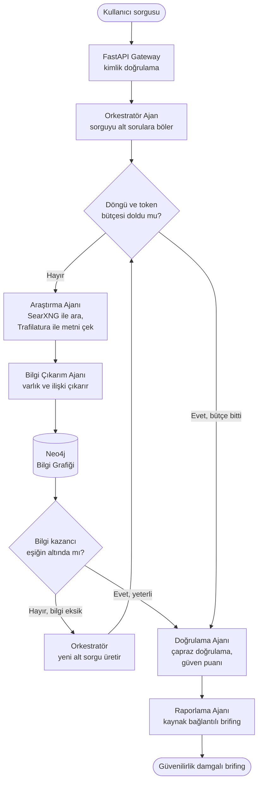

# Akış Diyagramları

## Akış 1: Uçtan uca sorgu → brifing (ReAct + durma ölçütü)

Kullanıcı sorgusu alt sorulara bölünür, araştırma döngüsü iki durma ölçütünden biri tetiklenene kadar sürer. İlgili ister: REQ-01, REQ-03, REQ-04.

