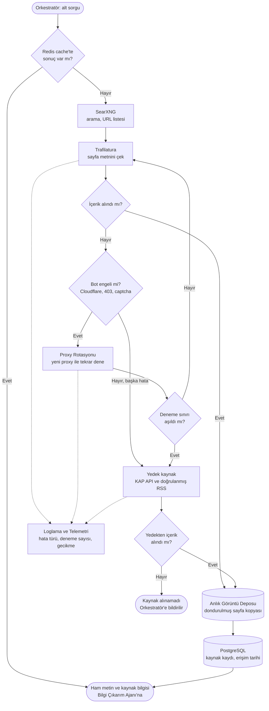

# Akış Diyagramları

## Akış 1: Uçtan uca sorgu → brifing (ReAct + durma ölçütü)

Kullanıcı sorgusu alt sorulara bölünür. Araştırma döngüsü ReAct mantığıyla (düşün, eylem yap, gözlemle) ilerler ve iki durma ölçütünden biri tetiklenince biter: bilgi kazancının eşiğin altına düşmesi ya da döngü ve token bütçesinin dolması. Bot engeli gibi hatalarda Akış 2 devreye girer. Doğrulama sonrası çelişki veya düşük güven varsa rapora açık uyarı eklenir. İlgili isterler: REQ-01, REQ-03, REQ-04.

## Akış 2: Web tarama ve içerik çekme (bot engeli, fallback)

Araştırma Ajanı, Orkestratör'den gelen alt sorguyu önce cache'te arar, bulamazsa SearXNG ile arar ve Trafilatura ile sayfa metnini çeker. Bot engelinde proxy rotasyonu denenir, sorun sürerse KAP API ve doğrulanmış RSS beslemelerine geçilir. Çekilen her sayfa anlık görüntü olarak saklanır (test kümesinin temeli). İlgili ister: REQ-01, REQ-06.

