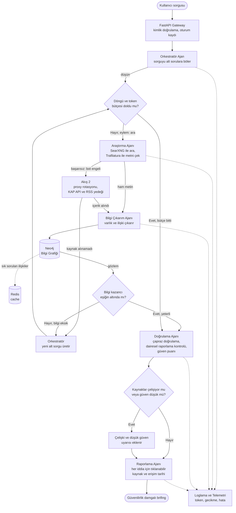
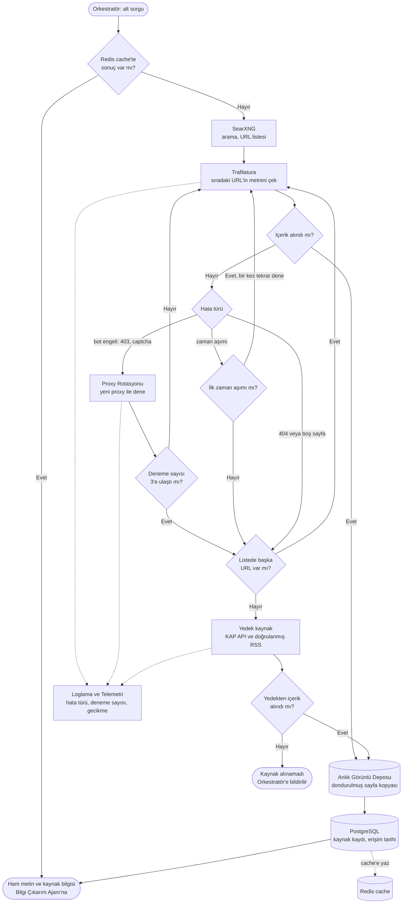
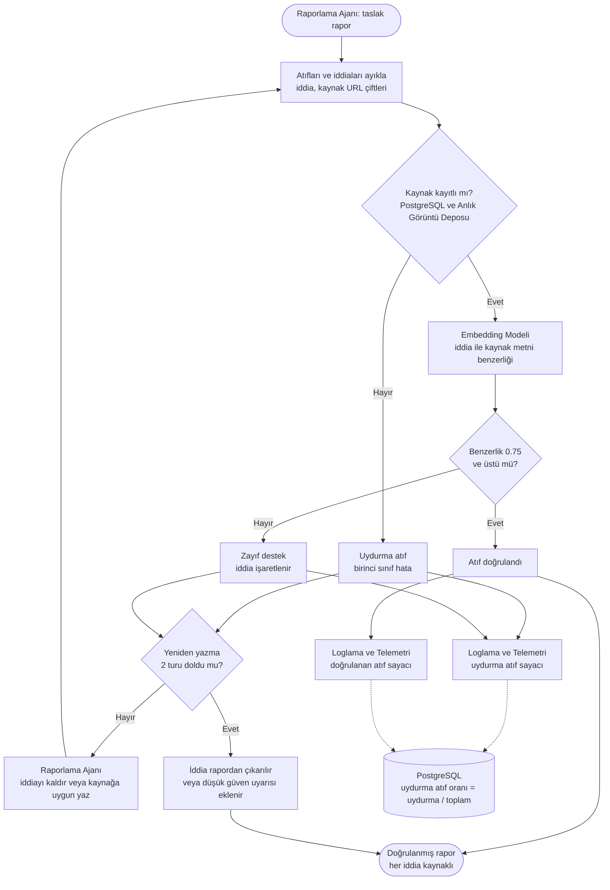

# Akış Diyagramları

## Akış 1: Uçtan uca sorgu → brifing (ReAct + durma ölçütü)

Kullanıcı sorgusu alt sorulara bölünür. Araştırma döngüsü ReAct mantığıyla (düşün, eylem yap, gözlemle) ilerler ve iki durma ölçütünden biri tetiklenince biter: bilgi kazancının eşiğin altına düşmesi ya da döngü ve token bütçesinin dolması. Bot engeli gibi hatalarda Akış 2 devreye girer. Doğrulama sonrası çelişki veya düşük güven varsa rapora açık uyarı eklenir. İlgili isterler: REQ-01, REQ-03, REQ-04.

## Akış 2: Web tarama ve içerik çekme (bot engeli, fallback)

Araştırma Ajanı alt sorguyu önce Redis cache'te arar (anahtar: normalize edilmiş sorgu ve URL, TTL 1 saat). Bulamazsa SearXNG ile URL listesi çıkarır ve her URL için Trafilatura ile metni çeker. Hataya göre yol ayrılır: bot engelinde proxy rotasyonu (en fazla 3 deneme), 404 veya boş sayfada sıradaki URL, zaman aşımında bir tekrar denemeden sonra sıradaki URL. URL listesi biterse KAP API ve doğrulanmış RSS yedeğine geçilir. Çekilen her sayfa anlık görüntü olarak saklanır (dondurulmuş test kümesinin temeli). İlgili isterler: REQ-01, REQ-06.

## Akış 4 (bonus): Atıf doğrulama

Raporlama Ajanı'nın ürettiği taslaktaki her atıf, yayımlanmadan önce iki kontrolden geçer. Birincisi varlık kontrolü: atıf yapılan kaynak gerçekten çekilmiş ve kayıtlı mı? İkincisi anlam kontrolü: iddia ile kaynak metni arasındaki embedding benzerliği eşiğin üstünde mi (başlangıç eşiği 0.75, dondurulmuş test kümesinde kalibre edilecek)? Kontrolü geçemeyen iddia taslaktan çıkarılır ya da yeniden yazılır (en fazla 2 tur). Uydurma atıf oranı log kayıtlarından ölçülür, hedef %5'in altı. İlgili isterler: REQ-06, REQ-03.

