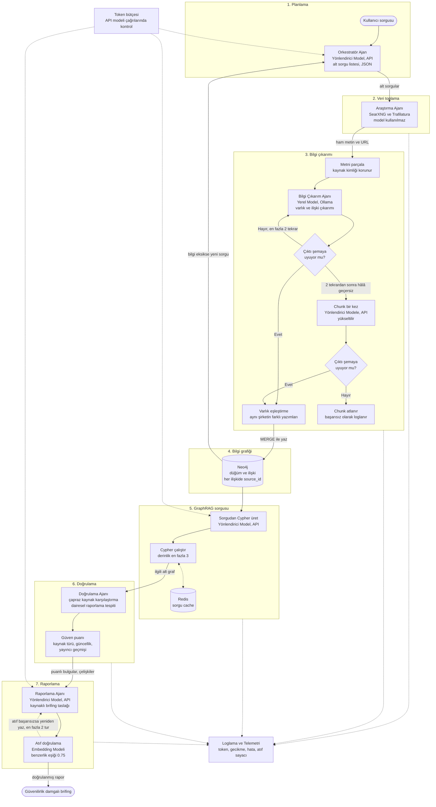

# AI Pipeline Diyagramı

Bir kullanıcı sorgusunun raporlanmış brifinge dönüşene kadar geçtiği model aşamaları ve aralarında akan veri biçimleri. Pahalı API modeli yalnızca planlama, sorgu üretimi ve rapor yazımında kullanılır. Standart çıkarım işleri yerel modelde (Ollama, Llama 3) çalışır. Doğrulama aşamasında dil modeli yerine embedding ve kural tabanlı kontroller kullanılır. İlgili isterler: REQ-01, REQ-02, REQ-04, REQ-06.

## Hangi aşamada hangi model

| Aşama | Model | Neden |
|-------|-------|-------|
| Planlama | Yönlendirici Model (API) | Alt sorgu üretimi akıl yürütme gerektirir |
| Veri toplama | Yok | Arama ve metin çekme araç işi |
| Bilgi çıkarımı | Yerel Model (Ollama, Llama 3). Şema 2 tekrarda tutmazsa chunk bir kez API modeline yükseltilir | Yüksek hacim, standart görev, token maliyeti sıfır. Yükseltme yalnızca zor chunk'lar için, maliyet düşük kalır |
| Sorgudan Cypher | Yönlendirici Model (API) | Hatalı sorgu graf sonucunu bozar, kaliteli model gerekir |
| Doğrulama | Model yok, kural ve puanlama | Tekrarlanabilir ve ölçülebilir olması için |
| Raporlama | Yönlendirici Model (API) | Kullanıcının gördüğü çıktı |
| Atıf doğrulama | Embedding Modeli | İddia ve kaynak metin benzerliği |

## Veri biçimleri

- Planlama çıkışı: `{"alt_sorgular": [...], "butce": {...}}`

- Çıkarım çıkışı: `{"varliklar": [...], "iliskiler": [{"kaynak", "tur", "hedef", "source_id"}]}`

- Doğrulama çıkışı: her bulgu için `guven_puani`, `celiski_var`, `kaynak_sayisi`

- Rapor: her iddia için `source_id`, URL ve erişim tarihi

