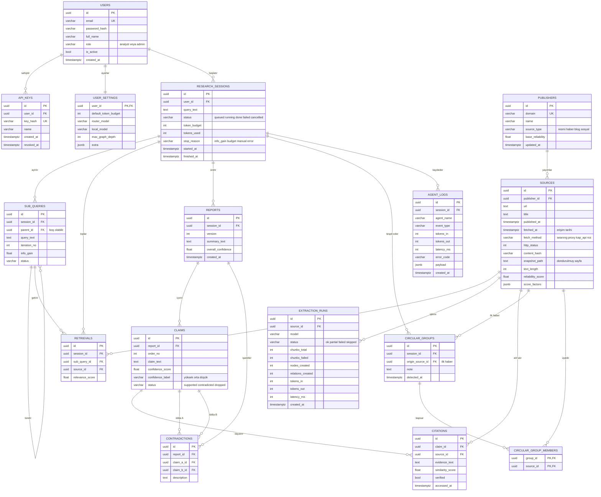

# ER Diyagramı (PostgreSQL)

Sistem hibrit depolama kullanır: ilişkisel veri (kullanıcı, oturum, kaynak, iddia, log) PostgreSQL'de, bilgi grafiği Neo4j'de tutulur. Bu belge PostgreSQL tarafını gösterir. Neo4j şeması için bkz. [06-neo4j-graf-semasi.md](06-neo4j-graf-semasi.md), alan açıklamaları için bkz. [07-veri-sozlugu.md](07-veri-sozlugu.md).

## Tablo grupları

| Grup | Tablolar | Amaç |
|------|----------|------|
| Kullanıcı ve erişim | `users`, `api_keys`, `user_settings` | Kimlik doğrulama, API erişimi (REQ-05), token bütçesi ve model ayarları |
| Araştırma süreci | `research_sessions`, `sub_queries`, `retrievals` | Sorgunun alt sorulara bölünmesi ve toplanan kaynaklar (REQ-01) |
| Kaynak ve güvenilirlik | `publishers`, `sources`, `circular_groups`, `circular_group_members` | Kaynak kaydı, dondurulmuş sayfa, güven puanı, dairesel raporlama tespiti (REQ-04) |
| Graf çıkarımı | `extraction_runs` | Her kaynaktan kaç düğüm ve ilişki çıkarıldığı (REQ-02) |
| Rapor ve atıf | `reports`, `claims`, `citations`, `contradictions` | Her iddianın kaynağı, erişim tarihi, çelişkiler (REQ-03, REQ-04, REQ-06) |
| Ölçüm | `agent_logs` | Token, gecikme ve hata kayıtları (p@95, uydurma atıf oranı) |

## Neo4j ile bağlantı

PostgreSQL ve Neo4j arasındaki köprü `sources.id` alanıdır. Graftaki her ilişkinin `source_ids` listesi, `sources` tablosundaki kayıtlara işaret eder. Böylece bir ilişkiye bakıp "bu bilgi hangi sayfadan, ne zaman çekildi?" sorusu yanıtlanabilir.

## Tasarım kararları

- **Kimlikler UUID:** Servisler arası çakışma olmaz, tahmin edilemez.
- **`sources` tablosu çekim kaydıdır:** Aynı URL farklı zamanlarda çekilirse ayrı satır olur. Aynı içerik `content_hash` ile tespit edilir. `fetched_at` doğrudan raporda gösterilen erişim tarihidir.
- **Uydurma atıf kontrolü (REQ-06):** `citations.source_id`, mutlaka aynı oturumda `retrievals` tablosuna girmiş bir kaynağa işaret etmelidir. Bu koşulu sağlamayan atıf birinci sınıf hata olarak `agent_logs`'a yazılır.
- **Çelişki ve dairesel raporlama:** `contradictions` iki iddiayı, `circular_groups` ise aynı ilk habere dayanan kaynak kümesini kaydeder. Güven puanı hesaplanırken bu kaynaklar tek bağımsız kaynak sayılır.
- **Migration:** Şema Alembic ile yönetilir (Hafta 4 teslimi).
- **İndeksler (öneri):** `sources(url)`, `sources(content_hash)`, `retrievals(session_id)`, `claims(report_id)`, `citations(claim_id)`, `agent_logs(session_id, created_at)`.
