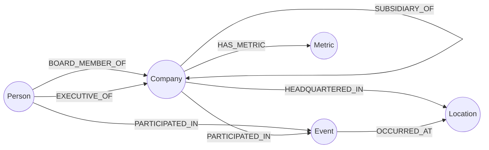

# Neo4j Graf Şeması

Bilgi Çıkarım Ajanı, çekilen metinlerden varlıkları (düğüm) ve aralarındaki ilişkileri (kenar) çıkarıp Neo4j'ye yazar. GraphRAG sorguları bu ağ üzerinde çok adımlı çıkarım yapar. İlişkisel veriler için bkz. [05-er-diyagrami.md](05-er-diyagrami.md).

## Şema diyagramı



## Düğüm türleri

| Etiket | Anlamı | Özellikler |
|--------|--------|------------|
| `Company` | Şirket veya kurum | `id`, `name`, `normalized_name`, `aliases`, `ticker`, `sector`, `needs_review` |
| `Person` | Kişi (yönetici, yatırımcı vb.) | `id`, `name`, `normalized_name`, `aliases`, `needs_review` |
| `Event` | Olay (atama, birleşme, bildirim, yatırım turu) | `id`, `type`, `title`, `date`, `description` |
| `Location` | Yer (şehir, ülke) | `id`, `name`, `country` |
| `Metric` | İstatistiksel veri (gelir, kâr, hisse fiyatı) | `id`, `name`, `value`, `unit`, `period` |

Tüm düğümlerde ortak alanlar: `source_ids` (düğümün geçtiği kaynaklar, PostgreSQL `sources.id`), `created_at`, `updated_at`.

## İlişki türleri

| İlişki | Yön | Anlamı | Ek özellikler |
|--------|-----|--------|---------------|
| `BOARD_MEMBER_OF` | Person → Company | Yönetim kurulu üyeliği | `since`, `until`, `role` |
| `EXECUTIVE_OF` | Person → Company | Üst düzey yönetici | `title`, `since`, `until` |
| `INVESTED_IN` | Company → Company | Yatırım | `amount`, `currency`, `date` |
| `COMPETITOR_OF` | Company → Company | Rakiplik (sorguda yönsüz okunur) | yok |
| `PARTNER_OF` | Company → Company | Ortaklık (sorguda yönsüz okunur) | `type`, `since`, `until` |
| `SUBSIDIARY_OF` | Company → Company | Bağlı ortaklık | `share_percent` |
| `HEADQUARTERED_IN` | Company → Location | Merkez konumu | yok |
| `PARTICIPATED_IN` | Person veya Company → Event | Olaya katılım | `role` |
| `OCCURRED_AT` | Event → Location | Olayın yeri | yok |
| `HAS_METRIC` | Company → Metric | Şirketin ölçümü | yok |

Tüm ilişkilerde ortak alanlar:

| Alan | Açıklama |
|------|----------|
| `source_ids` | Bilginin dayandığı kaynaklar (PostgreSQL `sources.id` listesi) |
| `evidence` | Bilginin geçtiği kısa kanıt cümlesi |
| `confidence` | Çıkarım güveni (0-1) |
| `first_seen`, `last_seen` | İlk ve son görülme zamanı |
| `extractor_model` | Çıkarımı yapan model |

## Kısıtlar ve indeksler

```cypher
// Benzersizlik kısıtları
CREATE CONSTRAINT company_id IF NOT EXISTS FOR (n:Company) REQUIRE n.id IS UNIQUE;
CREATE CONSTRAINT person_id IF NOT EXISTS FOR (n:Person) REQUIRE n.id IS UNIQUE;
CREATE CONSTRAINT event_id IF NOT EXISTS FOR (n:Event) REQUIRE n.id IS UNIQUE;
CREATE CONSTRAINT location_id IF NOT EXISTS FOR (n:Location) REQUIRE n.id IS UNIQUE;
CREATE CONSTRAINT metric_id IF NOT EXISTS FOR (n:Metric) REQUIRE n.id IS UNIQUE;

// Varlık eşleştirme için indeksler
CREATE INDEX company_norm IF NOT EXISTS FOR (n:Company) ON (n.normalized_name);
CREATE INDEX person_norm IF NOT EXISTS FOR (n:Person) ON (n.normalized_name);
CREATE INDEX company_ticker IF NOT EXISTS FOR (n:Company) ON (n.ticker);
CREATE INDEX event_date IF NOT EXISTS FOR (n:Event) ON (n.date);

// Benzer ad araması
CREATE FULLTEXT INDEX entity_names IF NOT EXISTS
FOR (n:Company|Person) ON EACH [n.name, n.aliases];
```

## Örnek yazma sorgusu (Bilgi Çıkarım Ajanı)

Aynı ilişki tekrar gelirse kopya oluşmaz, yalnızca kaynak listesi genişler:

```cypher
MERGE (p:Person {id: $person_id})
  ON CREATE SET p.name = $person_name, p.normalized_name = $person_norm, p.created_at = datetime()
MERGE (c:Company {id: $company_id})
  ON CREATE SET c.name = $company_name, c.normalized_name = $company_norm, c.created_at = datetime()
MERGE (p)-[r:BOARD_MEMBER_OF]->(c)
  ON CREATE SET r.since = date($since), r.first_seen = datetime(), r.source_ids = [$source_id],
                r.evidence = $evidence, r.confidence = $confidence, r.extractor_model = $model
  ON MATCH SET r.last_seen = datetime(),
               r.source_ids = r.source_ids + CASE WHEN $source_id IN r.source_ids THEN [] ELSE [$source_id] END;
```

## Örnek GraphRAG sorgusu

Öneri formundaki örnek soru: *"X şirketinin yeni yönetim kurulu üyesi, geçmişte hangi rakip firmalarla ortaklık yaptı?"*

```cypher
MATCH (x:Company {normalized_name: $company})<-[bm:BOARD_MEMBER_OF]-(p:Person)
WHERE bm.since >= date($since) AND bm.until IS NULL
MATCH (p)-[past:BOARD_MEMBER_OF|EXECUTIVE_OF]->(firm:Company)
WHERE firm <> x
MATCH (firm)-[pt:PARTNER_OF]-(partner:Company)-[:COMPETITOR_OF]-(x)
RETURN p.name AS kisi, firm.name AS onceki_firma, partner.name AS rakip_ortak,
       pt.source_ids AS kaynaklar, pt.confidence AS guven
LIMIT 25;
```

Bu sorgu vektör aramasıyla tek belgeden cevaplanamaz: bilgi dört farklı ilişkiye ve çoğunlukla farklı haber kaynaklarına dağılmıştır. `source_ids` alanı sayesinde cevaptaki her bağlantı kaynağına kadar izlenir (REQ-03).

## Performans notları (REQ-05, risk planı)

- Değişken uzunluklu yollar en fazla `*1..3` ile sınırlandırılır.
- Sorgular her zaman indeksli bir başlangıç düğümüyle (`normalized_name`, `ticker`) başlar.
- Sık sorulan ilişkiler Redis'te önbelleğe alınır.
- Hedef: p@95 gecikme için örnek eşik 2500 ms (ölçüm Hafta 9).
