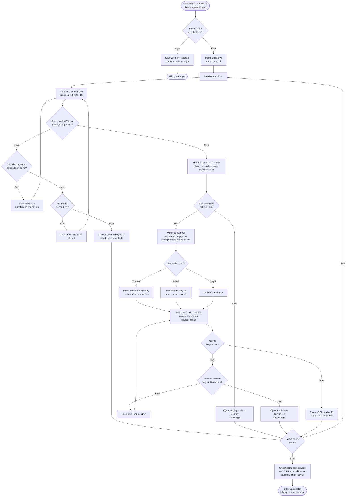

# Akış Diyagramı: Varlık-İlişki Çıkarımı ve Neo4j'ye Yazma

**İlgili ister:** REQ-02 Dinamik Ağ Kurulumu
**İlgili bileşen:** Bilgi Çıkarım Ajanı (Katman 2), Neo4j, PostgreSQL, Redis

Araştırma Ajanı'nın çektiği ham metin burada düğüm ve ilişkilere dönüştürülür. Diyagram mutlu yolu ve hata dallarını birlikte gösterir.

## Hata dalları

| Hata durumu | Tespit | Sistem davranışı | Loglanan olay |
|-------------|--------|------------------|---------------|
| Metin boş veya çok kısa | Karakter sayısı eşiğin altında | Kaynak işaretlenir, çıkarım atlanır | `extraction_skipped_low_content` |
| LLM geçersiz JSON döndürdü | JSON ayrıştırma veya şema doğrulama hatası | Hata mesajıyla en fazla 2 kez tekrar denenir | `extraction_retry` |
| Yerel model başarısız | 2 yeniden deneme sonrası hâlâ geçersiz | Chunk bir kez API modeline yükseltilir | `extraction_escalated` |
| API modeli de başarısız | Yükseltme sonrası hâlâ geçersiz | Chunk "çıkarım başarısız" olur, akış sonraki chunk ile devam eder | `extraction_failed` |
| LLM metinde olmayan bilgi üretti | Kanıt cümlesi chunk içinde bulunamıyor | Öğe atılır (REQ-06 ile uyumlu) | `extraction_ungrounded` |
| Belirsiz varlık eşleşmesi | Benzerlik skoru iki eşik arasında | Yeni düğüm açılır, `needs_review` işaretlenir | `entity_ambiguous` |
| Neo4j yazma hatası | Bağlantı veya zaman aşımı | En fazla 3 kez üstel geri çekilmeyle denenir, sonra Redis hata kuyruğuna alınır | `graph_write_retry`, `graph_write_dead_letter` |

## Tasarım notları

- **Kanıt zorunluluğu:** LLM her varlık ve ilişki için kaynak cümleyi (`evidence`) de döndürür. Bu cümle chunk metninde yoksa öğe atılır. Böylece uydurma bilgi grafiğe girmeden engellenir.
- **MERGE kullanımı:** Aynı varlık tekrar geldiğinde kopya düğüm oluşmaz, yalnızca `source_ids` listesine yeni kaynak eklenir.
- **Hataya dayanıklılık:** Bir chunk'ın başarısız olması tüm araştırmayı durdurmaz. Başarısız chunk sayısı Orkestratör'e raporlanır.
- **Eşikler:** Benzerlik eşikleri ve yeniden deneme sayıları ayarlanabilir olarak tasarlanır, ilk değerler baseline çalışmasında belirlenir (Hafta 3).
